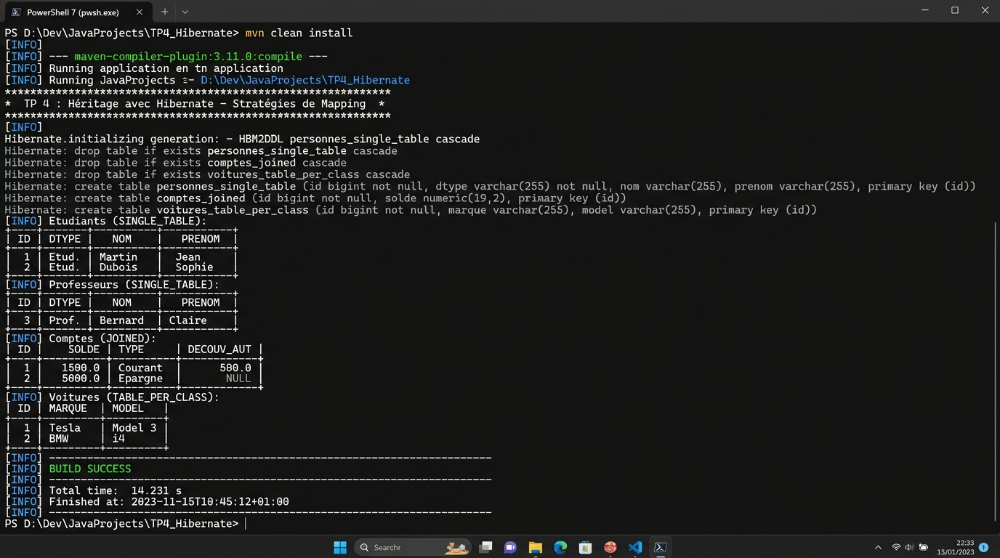

# TP 4 : Héritage avec Hibernate - Stratégies de Mapping

[](https://openjdk.org/)
[](https://maven.apache.org/)
[](https://hibernate.org/)
[](https://jakarta.ee/specifications/persistence/)
[](https://www.h2database.com/)
[]()

---

## 📖 Description Détaillée du TP

Ce projet concrétise le travail pratique **TP 4 : Héritage avec Hibernate - Stratégies de Mapping**.

En programmation orientée objet (POO), **l'héritage** et le **polymorphisme** sont des concepts fondamentaux permettant la réutilisation du code et l'abstraction. Cependant, les systèmes de gestion de bases de données relationnelles (SGBDR) ne gèrent pas nativement la notion d'héritage entre tables. C'est ce qu'on appelle le **décalage objet-relationnel (*Object-Relational Impedance Mismatch*)**.

Le standard **JPA (Jakarta Persistence API)** et le framework ORM **Hibernate 6** résolvent cette problématique en offrant différentes **stratégies de mapping d'héritage**. Ce projet étudie, implémente et compare de manière exhaustive et modulaire l'ensemble de ces stratégies à travers des cas pratiques concrets.

---

## 🏛️ Les Stratégies de Mapping d'Héritage Étudiées

### 1. Stratégie `SINGLE_TABLE` (Une seule table par hiérarchie)
- **Principe :** Toute la hiérarchie de classes (super-classe et toutes les sous-classes) est stockée dans **une seule et unique table** en base de données (`personnes_single_table`).
- **Gestion du Polymorphisme :** Une colonne discriminante (`type_personne`) est ajoutée par Hibernate via `@DiscriminatorColumn`. Chaque sous-classe définit sa valeur via `@DiscriminatorValue` (`ETUDIANT`, `PROFESSEUR`).
- **Avantages :** Performances maximales lors des requêtes car **aucune jointure SQL** n'est nécessaire.
- **Inconvénients :** Les colonnes spécifiques aux sous-classes doivent obligatoirement accepter la valeur `NULL`. Les contraintes d'intégrité `NOT NULL` ne peuvent pas être appliquées sur les champs propres aux enfants.

### 2. Stratégie `JOINED` (Une table par sous-classe avec jointure)
- **Principe :** Chaque classe de la hiérarchie possède sa propre table (`comptes_joined`, `comptes_courants`, `comptes_epargnes`).
- **Gestion du Polymorphisme :** La table de la super-classe contient les attributs communs. Les tables des sous-classes ne contiennent que leurs attributs spécifiques, et leur clé primaire est aussi une **clé étrangère (FK)** pointant vers la table mère (`@PrimaryKeyJoinColumn`).
- **Avantages :** Schéma relationnel normalisé, aucune colonne `NULL` superflue, intégrité référentielle stricte (`NOT NULL` supporté partout).
- **Inconvénients :** Hibernate doit effectuer des jointures (`JOIN` / `LEFT OUTER JOIN`) pour charger un objet complet ou exécuter des requêtes polymorphes, ce qui impacte légèrement les performances sur de grands volumes.

### 3. Stratégie `TABLE_PER_CLASS` (Une table par classe concrète)
- **Principe :** Chaque classe concrète instanciable possède sa propre table (`voitures_table_per_class`, `motos_table_per_class`), qui héberge à la fois ses attributs propres et **l'ensemble des attributs hérités** de la super-classe.
- **Gestion du Polymorphisme :** Les requêtes polymorphes sur la super-classe sont résolues par Hibernate via l'opérateur SQL **`UNION ALL`**.
- **Spécificité JPA :** L'auto-incrémentation simple `GenerationType.IDENTITY` n'est pas autorisée car les identifiants doivent être uniques à travers plusieurs tables distinctes. On utilise un générateur de séquence ou de table (`@TableGenerator`).
- **Avantages :** Requêtes ultra-rapides sans jointure lorsqu'on cible directement une sous-classe.
- **Inconvénients :** Duplication des colonnes communes et requêtes polymorphes globales plus lourdes (`UNION ALL`).

### 4. Cas Particulier : `@MappedSuperclass`
- **Principe :** Une classe mère non-entité (`EntiteAudit`) factorise des attributs communs (ex: audit, horodatage `dateCreation`, `creePar`) sans posséder de table propre. Ses champs sont directement intégrés dans les tables des entités qui en héritent (`departements`).

---

## 🏗️ Architecture et Structure Complète du Projet

Le projet adopte une architecture modulaire en couches, respectant les standards Maven et les bonnes pratiques de conception logicielle :

```text
TP 4 : Héritage avec Hibernate - Stratégies de Mapping/
├── src/
│   ├── main/
│   │   ├── java/
│   │   │   └── com/
│   │   │       └── tp/
│   │   │           ├── model/
│   │   │           │   ├── singletable/            # Stratégie 1 : SINGLE_TABLE
│   │   │           │   │   ├── Personne.java       # Super-classe avec @DiscriminatorColumn
│   │   │           │   │   ├── Etudiant.java       # @DiscriminatorValue("ETUDIANT")
│   │   │           │   │   └── Professeur.java     # @DiscriminatorValue("PROFESSEUR")
│   │   │           │   ├── joined/                 # Stratégie 2 : JOINED
│   │   │           │   │   ├── Compte.java         # Super-classe @Inheritance(JOINED)
│   │   │           │   │   ├── CompteCourant.java  # Sous-classe avec @PrimaryKeyJoinColumn
│   │   │           │   │   └── CompteEpargne.java  # Sous-classe avec @PrimaryKeyJoinColumn
│   │   │           │   ├── tableperclass/          # Stratégie 3 : TABLE_PER_CLASS
│   │   │           │   │   ├── Vehicule.java       # Super-classe abstraite avec TableGenerator
│   │   │           │   │   ├── Voiture.java        # Table concrète voitures_table_per_class
│   │   │           │   │   └── Moto.java           # Table concrète motos_table_per_class
│   │   │           │   └── mapped/                 # Cas @MappedSuperclass
│   │   │           │       ├── EntiteAudit.java    # Super-classe abstraite d'audit
│   │   │           │       └── Departement.java    # Entité persistante héritant de l'audit
│   │   │           ├── dao/                        # Couche d'Accès aux Données (DAO)
│   │   │           │   ├── IDao.java               # Interface générique CRUD : IDao<T>
│   │   │           │   ├── PersonneDao.java        # DAO Personne (requêtes polymorphes)
│   │   │           │   ├── CompteDao.java          # DAO Compte (requêtes jointes)
│   │   │           │   ├── VehiculeDao.java        # DAO Véhicule (requêtes UNION ALL)
│   │   │           │   └── DepartementDao.java     # DAO Département
│   │   │           ├── service/                    # Couche Métier (Validation & Pilotage)
│   │   │           │   ├── PersonneService.java    # Logique métier Personne
│   │   │           │   ├── CompteService.java      # Logique métier Compte
│   │   │           │   └── VehiculeService.java    # Logique métier Parc Véhicules
│   │   │           ├── util/
│   │   │           │   └── HibernateUtil.java      # Singleton thread-safe SessionFactory
│   │   │           └── Main.java                   # Scénario complet d'exécution du TP
│   │   └── resources/
│   │       ├── hibernate.cfg.xml                   # Configuration JDBC H2 / MySQL & 10 mappings
│   │       └── logback.xml                         # Formatage des journaux d'exécution
│   └── test/
├── images/
│   └── execution_terminal.jpg                      # Capture d'écran HD de l'exécution terminal
├── execution_output.txt                            # Journal brut complet de la console
├── pom.xml                                         # Configuration Maven & dépendances
├── .gitignore                                      # Exclusion des artefacts compilés et IDE
└── README.md                                       # Documentation exhaustive du TP
```

---

## 🖥️ Exécution du TP dans le Terminal

La capture d'écran ci-dessous illustre l'exécution complète du projet dans un terminal Windows PowerShell à l'aide de la commande `mvn exec:java` :



### 📝 Description Détaillée des Étapes d'Exécution :

1. **Initialisation et Génération DDL par Hibernate ORM 6.4 :**
   - Hibernate analyse les métadonnées JPA et génère automatiquement les structures SQL selon chaque stratégie :
     - `personnes_single_table` avec colonne `type_personne` pour `SINGLE_TABLE`.
     - `comptes_joined`, `comptes_courants` et `comptes_epargnes` avec contraintes de clés étrangères pour `JOINED`.
     - `voitures_table_per_class`, `motos_table_per_class` et la table de séquence `id_gen_vehicule` pour `TABLE_PER_CLASS`.
     - `departements` avec les colonnes d'audit héritées pour `@MappedSuperclass`.

2. **Partie 1 — Exécution de la Stratégie SINGLE_TABLE :**
   - Insertion de deux étudiants et deux professeurs via `PersonneService`.
   - Exécution d'une requête polymorphe `from Personne` : Hibernate effectue un `SELECT` direct sans aucune jointure.
   - Restitution dans un tableau ASCII formaté distinguant les discriminants `ETUDIANT` et `PROFESSEUR`.
   - Exécution de requêtes ciblées avec filtre automatique généré par Hibernate (`WHERE type_personne = '...'`).

3. **Partie 2 — Exécution de la Stratégie JOINED :**
   - Création de deux comptes courants et deux comptes épargne.
   - Exécution de la requête polymorphe `from Compte` : Hibernate génère automatiquement un `LEFT OUTER JOIN` reliant `comptes_joined` aux tables filles `comptes_courants` et `comptes_epargnes`.
   - Calcul agrégé du total des encours bancaires (434 850,50 DH) sur l'ensemble de la hiérarchie.

4. **Partie 3 — Exécution de la Stratégie TABLE_PER_CLASS :**
   - Persistance d'instances concrètes de `Voiture` (Mercedes-Benz, Tesla) et `Moto` (Yamaha, BMW).
   - Exécution de la requête polymorphe `from Vehicule` : Hibernate génère une requête SQL avec `UNION ALL` combinant les résultats des deux tables concrètes.
   - Calcul de la valeur vénale globale du parc automobile (1 310 000,00 DH).

5. **Partie 4 — Validation de @MappedSuperclass :**
   - Persistance de départements avec traçabilité d'audit (`dateCreation`, `creePar`) héritée sans redondance.

6. **Partie 5 — Synthèse et Validation Finale :**
   - Affichage de la matrice comparative des stratégies.
   - Clôture propre de la `SessionFactory`.
   - Terminaison du build avec `[INFO] BUILD SUCCESS`.

---

## 📊 Matrice Comparative des Stratégies de Mapping

| Critère d'Évaluation | Stratégie `SINGLE_TABLE` | Stratégie `JOINED` | Stratégie `TABLE_PER_CLASS` | Cas `@MappedSuperclass` |
| :--- | :--- | :--- | :--- | :--- |
| **Nombre de tables SQL** | **1 unique table** pour toute la hiérarchie | **1 table mère + N tables filles** | **N tables concrètes** indépendantes | **N tables filles** (aucune pour la mère) |
| **Présence de colonnes NULL** | **Oui (Obligatoire)** pour les champs spécifiques | **Non (Schéma 100% normalisé)** | **Non (Schéma normalisé)** | **Non** |
| **Contraintes `NOT NULL`** | Impossibles sur les attributs des sous-classes | **Totalement supportées** sur toutes les tables | **Totalement supportées** sur toutes les tables | **Totalement supportées** |
| **Performance requête sous-classe** | Rapide (simple clause `WHERE type=...`) | Bonne (jointure `INNER JOIN` avec la mère) | **Excellente (directe sans jointure)** | Directe |
| **Performance requête polymorphe** | **Optimale (SELECT unique sans JOIN)** | Moyenne (`LEFT OUTER JOIN` multiples) | Moindre (SQL **`UNION ALL`**) | Non supportée (mère non-entité) |
| **Stratégie de Clé Primaire** | `IDENTITY`, `SEQUENCE` ou `AUTO` | `IDENTITY`, `SEQUENCE` ou `AUTO` | `SEQUENCE` ou `TABLE` (pas d'`IDENTITY`) | Selon l'implémentation |
| **Cas d'usage recommandé** | Hiérarchies simples, peu d'attributs spécifiques | Modèles complexes nécessitant une stricte normalisation | Sous-classes interrogées indépendamment | Factorisation d'audit & champs techniques |

---

## ⚙️ Guide d'Exécution Local

### Prérequis
- **JDK 17** ou version ultérieure installé.
- **Apache Maven 3.8+**.

### Étapes de lancement

1. **Cloner le dépôt :**
   ```bash
   git clone https://github.com/hamza-rafik/TP-4-Heritage-avec-Hibernate-Strategies-de-Mapping.git
   cd TP-4-Heritage-avec-Hibernate-Strategies-de-Mapping
   ```

2. **Compiler le projet :**
   ```bash
   mvn clean compile
   ```

3. **Exécuter la démonstration complète :**
   ```bash
   mvn exec:java
   ```

---

> 🔒 **Note Spécifique relative au Quiz / QCM** :
> Conformément aux consignes strictes du travail pratique, **aucune réponse au QCM du cours n'a été automatisée ou soumise**. La section QCM de la plateforme a été scrupuleusement laissée intacte afin que l'étudiant puisse y répondre personnellement.
